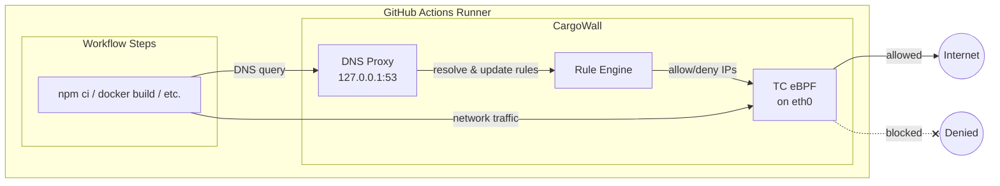

# CargoWall GitHub Action
[](https://github.com/code-cargo/cargowall-action/actions/workflows/test.yml)
[](https://github.com/code-cargo/cargowall-action/actions/workflows/check-dist.yml)
[](LICENSE)
[](https://github.com/code-cargo/cargowall-action/releases)

The official GitHub Action for [CargoWall](https://github.com/code-cargo/cargowall) — an eBPF-based network firewall for GitHub Actions runners that monitors and controls outbound connections during CI/CD runs.

Secure your GitHub Actions workflows with eBPF-based network egress filtering. Prevent supply chain attacks, block data exfiltration, and control outbound connections at the kernel level.

For concepts, architecture, and platform capabilities, see the [main CargoWall repository](https://github.com/code-cargo/cargowall).

## Features

- **eBPF-based filtering**: Uses kernel-level filtering for high performance and reliability
- **Hostname filtering**: Allow/deny based on domain names
  - Subdomains are automatically allowed (i.e. `example.com` would also allow `api.example.com`), with `*`/`**` wildcards when you need tighter control — see [How Hostnames Match](#how-hostnames-match)
  - CNAME chains of allowed hosts are followed transparently — if an allowed host resolves through a moving CDN edge, the chain's target names and IPs are allowed automatically, so you don't have to wildcard churning CDN targets
- **CIDR filtering**: Allow/deny based on IP address ranges
- **DNS tunneling prevention**: Blocks DNS queries for non-allowed domains
- **Docker support**: Automatically configures Docker containers to respect firewall rules
- **Sudo lockdown**: Optionally restrict sudo for the job's user to an allowlist; see [Sudo Lockdown](#sudo-lockdown) for its limits
- **Graceful degradation**: Warns and continues if eBPF is unavailable

## Quick Start

List only the hosts your build needs. GitHub and Actions hosts are already allowed on port 443 — see [Automatically Allowed Traffic](#automatically-allowed-traffic).

```yaml
- uses: code-cargo/cargowall-action@v1
  with:
    allowed-hosts: |
      registry.npmjs.org
```

Everything else is denied by default.

## Usage

### Basic Example

```yaml
name: Secure Build

on: [push, pull_request]

jobs:
  build:
    runs-on: ubuntu-latest
    permissions:
      contents: read
      id-token: write
    steps:
      - uses: actions/checkout@v4

      - uses: code-cargo/cargowall-action@v1
        with:
          allowed-hosts: |
            registry.npmjs.org

      - run: npm ci
      - run: npm run build
      - run: npm test
```

> **Note:** The action connects to the [CodeCargo platform](https://www.codecargo.com) by default. For full integration, your job needs these permissions: `id-token: write` (OIDC authentication) and `contents: read`. If `id-token: write` is not granted, the action will warn and continue without API integration. Set `offline: true` to skip API communication entirely.
>
> The action makes **no GitHub API calls** — `actions: read` is not used. Per-step attribution is causal (eBPF process/socket tagging in the cargowall binary) and step names come from the runner's local Worker log: each step that ran, with the runner's id for it (the `GITHUB_ACTION` its processes carry). A cargowall binary that reads those ids names each step's processes by the id it reads from them in the kernel; an older one matches them by time. Steps skipped by `if:` are left out.

### How Hostnames Match

A plain hostname also matches its subdomains, at any depth:

- `example.com` matches `example.com`, `api.example.com`, and `a.b.example.com`

A hostname containing a wildcard matches **only** what the pattern says — it gets no automatic subdomain matching. `*` matches exactly one DNS label, `**` matches one or more:

- `*.example.com` matches `api.example.com`, but **not** `example.com` or `a.b.example.com`
- `**.example.com` matches `api.example.com` and `a.b.example.com`, but **not** `example.com`

These are two different mechanisms, so the plain form is the broader one: `example.com` allows the apex *and* every subdomain, while `*.example.com` excludes the apex. Reach for a wildcard when you want to *exclude* the apex or pin the depth — not as a way to "add" subdomains.

```yaml
- uses: code-cargo/cargowall-action@v1
  with:
    allowed-hosts: |
      *.github.com
      **.ubuntu.com
      registry.npmjs.org
```

### Restricting Ports

An `allowed-hosts` entry allows **all ports** by default. Append `:port` to scope it, and separate multiple ports with `;`:

```yaml
- uses: code-cargo/cargowall-action@v1
  with:
    allowed-hosts: |
      registry.npmjs.org:443
      internal.example.com:443;80
```

The [automatically allowed](#automatically-allowed-traffic) GitHub and Azure service hostnames are always scoped to port 443. This is why adding `github.com` to `allowed-hosts` is not a no-op: it is *broader* than the built-in rule, opening every port rather than just 443.

### With DNS Search Domains

Cloud runners resolve internal hosts through a DNS search domain. A search-domain suffix is stripped before rule matching, and any name ending in one passes the DNS proxy even without a matching hostname rule — useful when the underlying traffic is already governed by a CIDR rule and per-hostname tracking would be wasteful.

**The suffixes for the detected cloud provider are added automatically** — you do not need to configure these:

| Detected environment                | Suffixes added automatically                                         |
|-------------------------------------|----------------------------------------------------------------------|
| AWS                                 | `.compute.internal`, `.ec2.internal`                                 |
| Azure (incl. GitHub-hosted runners) | `.internal.cloudapp.net`                                             |
| GCP                                 | `.google.internal`                                                   |
| Kubernetes (always)                 | `.cluster.local`, `.svc.cluster.local`, `.default.svc.cluster.local` |

Use `search-domains` for suffixes that auto-detection does not cover — a self-hosted runner, a custom internal zone, or GCP's `.c.PROJECT_ID.internal` (omitted above because it requires a metadata lookup):

```yaml
- uses: code-cargo/cargowall-action@v1
  with:
    allowed-cidrs: |
      10.0.0.0/8
    search-domains: |
      .internal.corp.example.com
```

With this configuration:
- A rule for `bastion` also matches `bastion.internal.corp.example.com` (the suffix is stripped before matching).
- Any name ending in a configured suffix passes the DNS proxy even without a matching hostname rule, while explicit deny rules still win.

Each suffix must have at least two labels (`.compute.internal` is valid, `.internal` is not) and cannot be a public suffix (`.com`, `.co.uk`, `.github.io`, … are rejected).

**The runner's own `resolv.conf` search list is honoured too — for stripping only.** On a host with `search corp.lan`, a stub resolver asks for `myservice.corp.lan` before `myservice`, so that expanded form is judged as `myservice` and a rule for `myservice` covers it. Unlike the suffixes above it grants no resolution bypass — `resolv.conf` is written by DHCP, not by you — so a name under it still needs a matching rule. Public suffixes on the list are ignored, the list is read once when the firewall starts, and it only ever *adds* a form to match: a host suffix never displaces the one your rules already match through a configured or Kubernetes suffix.

This matters most for clients using c-ares (Node's `dns.resolve*`, grpcio, some curl builds), which end their search on the first refused multi-label attempt: without the stripping, an allowed single-label name was unresolvable on any runner with a search list, and every lookup logged a blocked query for a name nobody asked about.

### With Docker Support

CargoWall automatically configures Docker to use its DNS proxy, so hostname filtering works inside containers:

```yaml
- uses: code-cargo/cargowall-action@v1
  with:
    allowed-hosts: |
      docker.io
      docker.com
      registry.npmjs.org

- name: Build Docker image
  run: docker build -t myapp .
```

### Audit Mode

Run in audit mode to log connections without blocking them — useful for understanding your workflow's network dependencies before enforcing rules:

```yaml
- uses: code-cargo/cargowall-action@v1
  with:
    mode: audit
```

A policy fetched from the [CodeCargo platform](#codecargo-platform) replaces `mode`, and `sudo-lockdown` and `sudo-allow-commands` too when the policy sets the sudo lockdown. With one in play, the start step doesn't announce `mode` as the run's mode, and the configuration echo shows it only as the fallback for a run where no policy loads. Once cargowall is ready, the step reports the mode it applies (`Mode: enforce (set by the CodeCargo policy)`) and the sudo lockdown: on, off, or not applied with cargowall's reason. Without a posture record from cargowall that the step can trust, it says the lockdown was not reported instead. So it does when the binary comes from `binary-path` or `source-ref` and the record has no lockdown line, since such a binary may predate the line.

### When the CodeCargo Policy Can't Be Fetched

The action fetches the resolved policy from the [CodeCargo platform](#codecargo-platform) at startup (unless `offline: true`), and `api-failure-mode` decides what happens when that fetch genuinely fails. **This default matters even if you don't use the platform** — see the trade-off note below the table.

```yaml
- uses: code-cargo/cargowall-action@v1
  with:
    api-failure-mode: audit   # default
```

| Value              | Behaviour on a retrieval failure                                                              |
|--------------------|-----------------------------------------------------------------------------------------------|
| `audit` *(default)* | Run in audit mode — log connections, block nothing. The build completes, and the downgrade is warned in the log and recorded for the dashboard |
| `enforce`           | Use this step's own configuration as-is (the behaviour before this input existed)              |
| `fail`              | Lock the runner down to deny-all and fail the step                                             |

> **Trade-off of the `audit` default — read this if you don't use the CodeCargo platform.** A retrieval failure downgrades the run to logging-only, and "retrieval failure" includes runners that can *never* reach `app.codecargo.com` — e.g. self-hosted runners with restricted egress — not just transient outages. On such a runner the firewall would downgrade on **every** run. If your policy lives in this workflow file rather than the CodeCargo platform, set `api-failure-mode: enforce` (keep enforcing this step's config), or `offline: true` (skip the API entirely — also keeps enforcing). Setting `mode:` explicitly has the same effect as `enforce` here, as shown below.

**Only genuine retrieval failures count**: the API being unreachable, a server error, a timeout, or a policy that can't be parsed. These do *not* count and always fall back to this step's configuration, whatever `api-failure-mode` says:

* the repository is not onboarded to CodeCargo (the everyday case for anyone without an account)
* the OIDC token was rejected, or the workflow is missing `permissions: id-token: write`
* the repository is marked inactive

That distinction keeps a **reachable** API's authoritative answers from ever changing your posture: a repo that isn't onboarded gets a 404 and keeps enforcing. It deliberately does not cover an *unreachable* API — that is a retrieval failure, and the trade-off note above applies.

**An explicit `mode` wins over the default.** If you wrote `mode: enforce` yourself, a fetch failure leaves you enforcing rather than downgrading you to audit — you asked for enforcement in so many words. Setting `api-failure-mode` explicitly overrides that:

| `mode`     | `api-failure-mode` | Posture on a retrieval failure |
|------------|--------------------|--------------------------------|
| unset      | unset              | audit                          |
| `enforce`  | unset              | enforce (your config)          |
| `enforce`  | `audit`            | audit                          |
| any        | `fail`             | deny-all lockdown, step fails  |

This input has no effect when `offline: true` or `api-url` is empty.

### With Sudo Lockdown

Enable sudo lockdown so that later steps can't use sudo to disable the firewall. With no allowlist (no `sudo-allow-commands`, and no CodeCargo policy that sets one), the job's steps get no sudo at all:

```yaml
- uses: code-cargo/cargowall-action@v1
  with:
    sudo-lockdown: true
```

See [Sudo Lockdown](#sudo-lockdown) for what an allowlist gives up, and for the lockdown's limits, docker access among them.

### With Config File

For complex configurations, give the job's rules as a JSON file:

```yaml
- uses: actions/checkout@v6   # the file comes from the repository

- uses: code-cargo/cargowall-action@v1
  with:
    config-file: .github/cargowall.json
```

**`.github/cargowall.json`**:
```json
{
  "defaultAction": "deny",
  "rules": [
    { "type": "hostname", "value": "github.com", "action": "allow" },
    { "type": "hostname", "value": "registry.npmjs.org", "action": "allow" },
    { "type": "cidr", "value": "10.0.0.0/8", "action": "allow",
      "ports": [{ "port": 443, "protocol": "tcp" }, { "port": 80, "protocol": "tcp" }] }
  ],
  "steps": [
    { "id": "publish", "rules": [{ "type": "hostname", "value": "npm.pkg.github.com" }] }
  ]
}
```

- **The file is this step's whole configuration.** It holds `rules`, `defaultAction` (deny when omitted), `searchDomains`, `sudoLockdown` (which replaces `sudo-lockdown` and `sudo-allow-commands`, as a policy's does) and `steps`, each step's own allow rules by its workflow `id:`. The pinned cargowall loads and validates `steps` but doesn't apply them to connections yet: until it binds steps to their rules, every step's connections get the job's rules alone. Their names do resolve, for every process in the job, and their addresses take room in the rule maps. So it can't be combined with `allowed-hosts`, `allowed-cidrs` or `search-domains`: give those in the file. `mode`, `github-service-hosts` and `azure-infra-hosts` apply as they do without a file, and so do `sudo-lockdown` and `sudo-allow-commands` unless the file sets `sudoLockdown`.
- **Every port entry needs a `protocol`:** `tcp`, `udp`, `icmp` or `all`, in lowercase, as in `{ "port": 443, "protocol": "tcp" }`. cargowall skips an entry without one, which leaves the rule on every port, so the step refuses such a file, and one with a rule key cargowall doesn't read.
- **A CodeCargo policy replaces it.** When a policy is fetched and loads, the file is neither read nor merged. The file applies when no policy loads: `offline: true`, `skip-policy-fetch: true`, no `api-url`, no OIDC token, or a fetch the API answers with no policy (not onboarded, a rejected token, an inactive repository).
- **A failed fetch keeps its [`api-failure-mode`](#when-the-codecargo-policy-cant-be-fetched)**, a policy cargowall can't load included. Under `audit` the run is downgraded to audit and under `enforce` it keeps this step's mode, each on the file; under `fail` it locks down and reads no local configuration.
- **When the file sets `sudoLockdown` and no policy loads,** the start step announces the file's lockdown, not the input, and once cargowall is ready reports the lockdown it applied.
- **A file that can't serve fails the step.** One that's missing, isn't a JSON object, or has a key cargowall doesn't read or a port entry without a protocol fails it before DNS is touched or cargowall starts. One cargowall can't load, such as a rule it rejects, leaves cargowall running deny-all with only CI infrastructure allowed; the step fails then too, once cargowall's log shows the file didn't load.

### Experimental: L7 Destination Identity (v2 Preview)

> **Experimental.** `container-egress` and `tls-sni` expose cargowall v2
> postures that are still being measured on real CI. They may change spelling
> or disappear before this action ships v2.0.0 — pin a commit SHA if you depend
> on them.

An L4 verdict allows a destination *IP*. When a hostname rule resolves to a
shared CDN or edge address (Cloudflare, Akamai, Fastly), that `/32` is open to
**every** tenant behind it — an attacker who puts their own domain on the same
CDN reaches an already-allowed IP, and the packet filter cannot tell the two
apart. The L7 layer pins *which* hostname a flow to that IP may reach, reading
the TLS SNI, the HTTP `Host` header, or the QUIC Initial. It never widens an L4
allow; it only narrows one.

It rides cargowall's root-cgroup egress hook, so the two knobs move together:

| `container-egress` | What the cgroup hook does                                                                                   |
|--------------------|-------------------------------------------------------------------------------------------------------------|
| `observe`          | *(default)* Correlates Docker containers and execs to workflow steps and records what it **would** block     |
| `enforce`          | Authoritative for traffic with a local socket (pre-NAT, in socket context); the TC hook stays as a backstop   |

| `tls-sni`        | What the L7 layer does                                                                          |
|------------------|-------------------------------------------------------------------------------------------------|
| `off`            | *(default)* No name is parsed                                                                    |
| `observe`        | Parses the presented name and records what it **would** drop, dropping nothing                   |
| `enforce`        | Drops a flow whose presented name no rule allows — the name alone, so an allowed name still opens any L7-scoped IP |
| `enforce-pinned` | Also drops when the name never resolved to *that* destination through cargowall's own DNS proxy, closing that gap |

Roll out observe-first — the `l7_would_block` records in the audit log are how
you find out what enforcement would cost before it costs it:

```yaml
- uses: code-cargo/cargowall-action@<sha>
  with:
    allowed-hosts: |
      github.com
    tls-sni: observe          # measure only; blocks nothing
```

Then, once the would-block set is empty (or understood), turn the drops on.
The enforce rungs require `container-egress: enforce`, because L7 can only
narrow a pass into a drop and there is nothing to narrow while the hook it
rides is still passing everything it would have blocked:

```yaml
- uses: code-cargo/cargowall-action@<sha>
  with:
    allowed-hosts: |
      github.com
    container-egress: enforce
    tls-sni: enforce
```

Worth knowing before you enable it:

- **Scope is port-based.** TCP/443 is read as TLS, TCP/80 as `Host`, UDP/443 as
  QUIC, plus the CDN alternate ports the same shared edges terminate on. Every
  other port stays governed by the L4 verdict alone — `ssh.github.com:22` is
  unaffected.
- **`mode: audit` still wins.** Audit mode remains the run's single source of
  "log, never block", so an enforce rung under it records and drops nothing.
- **A new flow costs one retransmit.** The presented name is matched in
  userspace against the live policy, so a new TLS flow is held until the
  verdict lands rather than leaking its first flight.
- **`container-egress` has no `off`.** The action's `--github-action` preset
  raises `off` to `observe`, so the hook cannot be disabled from here.
- **An enforce rung that can't be applied fails the step.** Under an
  enforcing policy, `container-egress: enforce` and the `tls-sni` enforce rungs
  fail closed: if the cgroup hook can't attach, or can't be limited to this
  job's traffic, CargoWall does not start, and the step fails whatever
  `fail-on-unsupported` says, since carrying on would run the job with no
  firewall at all. Under `mode: audit` the hook drops nothing even at
  `enforce`, so losing it only warns, as an `observe` rung does: the run keeps
  the TC hook's L4-only verdict, and the shared-edge hole stays open for that
  run.
- **ARC with `containerMode: dind` needs `shareProcessNamespace: true`** on the
  runner pod for `container-egress: enforce`. dind makes its containers' cgroups
  outside the pod's cgroup, and CargoWall can judge them only when dind's
  processes share its pid namespace. Stock ARC templates don't set it. Without
  it, CargoWall refuses enforce ("the docker daemon's pid is outside our pid
  namespace") and does not start.

## Inputs

| Input                        | Description                                                                                                                                                                                                                                                                            | Default                                        |
|------------------------------|----------------------------------------------------------------------------------------------------------------------------------------------------------------------------------------------------------------------------------------------------------------------------------------|------------------------------------------------|
| `mode`                       | Enforcement mode: `enforce` (block) or `audit` (log only)                                                                                                                                                                                                                              | `enforce`                                      |
| `allowed-hosts`              | Allowed hostnames, one per line. Matches subdomains, supports `*`/`**` wildcards, and allows all ports unless you append `:port` (`;`-separated for several). See [How Hostnames Match](#how-hostnames-match)                                                                                                       |                                                |
| `allowed-cidrs`              | Allowed CIDR blocks, one per line                                                                                                                                                                                                                                                      |                                                |
| `search-domains`             | Extra DNS search-domain suffixes, one per line — stripped before hostname-rule matching and bypassed for unmatched DNS queries. The detected cloud provider's suffixes are added [automatically](#with-dns-search-domains). Each suffix needs ≥2 labels and cannot be a public suffix. |                                                |
| `github-service-hosts`       | GitHub service hostnames to auto-allow on port 443 (one per line). Replaces the default list rather than adding to it; an empty value is an error                                                                                                                                      | See [defaults](#automatically-allowed-traffic) |
| `azure-infra-hosts`          | Azure infrastructure hostnames to auto-allow on port 443 (one per line), applied only on Azure. Replaces the default list rather than adding to it; an empty value is an error                                                                                                         | See [defaults](#automatically-allowed-traffic) |
| `config-file`                | A JSON file that is this step's whole configuration, used when no CodeCargo policy loads. Not combinable with `allowed-hosts`, `allowed-cidrs` or `search-domains`; see [With Config File](#with-config-file)                                                                          |                                                |
| `fail-on-unsupported`        | Fail if CargoWall can't run here (eBPF unsupported, or startup failed) rather than warn and continue. Enforcement the runner can't apply [always fails the step](#cargowall-refused-to-start)                                                                                          | `false`                                        |
| `sudo-lockdown`              | Restrict sudo for the job's user to the allowlist. Allowlisted commands and docker access are outside it — see [Sudo Lockdown](#sudo-lockdown)                                                                                                                                         | `false`                                        |
| `sudo-allow-commands`        | Command paths to allow via sudo when locked, one per line                                                                                                                                                                                                                              |                                                |
| `dns-upstream`               | Upstream DNS server (auto-detected if not set)                                                                                                                                                                                                                                         | auto-detect                                    |
| `allow-existing-connections` | Allow pre-existing TCP connections at startup                                                                                                                                                                                                                                          | `true`                                         |
| `binary-path`                | Path to a pre-built cargowall binary. Skips the download, and with it the pinned-digest verification — see [Setup fails downloading the binary](#setup-fails-downloading-the-binary)                                                                                                    |                                                |
| `source-ref`                 | Build cargowall from source at this branch/tag of `code-cargo/cargowall` instead of downloading a release (testing only; no checksum/provenance verification). `binary-path` takes precedence                                                                                           |                                                |
| `debug`                      | Enable debug logging                                                                                                                                                                                                                                                                   | `false`                                        |
| `audit-summary`              | Render the audit summary into the workflow run summary. **Rendering only** — event collection and the CodeCargo API push happen either way; use `offline: true` to stop API communication                                                                                               | `true`                                         |
| `github-token`               | GitHub token used only to retry the binary download authenticated when the anonymous request is throttled — the action makes no other GitHub API calls                                                                                                                                 | `${{ github.token }}`                          |
| `api-url`                    | CodeCargo API URL for audit upload and policy fetch (policy requires GitHub App)                                                                                                                                                                                                       | `https://app.codecargo.com`                    |
| `api-failure-mode`           | Posture when the policy can't be retrieved from the CodeCargo API: `audit`, `enforce`, or `fail`. Only genuine retrieval failures act on it — but an *unreachable* API counts, so the `audit` default affects non-platform repos too. See [When the CodeCargo Policy Can't Be Fetched](#when-the-codecargo-policy-cant-be-fetched)                                               | `audit` (`enforce` if `mode` is set)           |
| `offline`                    | Skip all CodeCargo API communication (audit upload and policy fetch)                                                                                                                                                                                                                   | `false`                                        |
| `skip-policy-fetch`          | Skip only the policy fetch, so the job runs exactly this step's configuration (a fetched policy would replace it) while the audit push still reports the job to the dashboard. Needs `id-token: write` and firewall rules that allow the `api-url` host; `offline: true` wins            | `false`                                        |
| `job-id`                     | Check run ID of the current job (from workflow context by default; override if needed)                                                                                                                                                                                                 | `${{ job.check_run_id }}`                      |
| `container-egress`           | **Experimental (v2 preview)** — root-cgroup egress hook posture: `observe` (report what it would block) or `enforce` (authoritative for traffic with a local socket). See [L7 Destination Identity](#experimental-l7-destination-identity-v2-preview)                                    | `observe` (from the preset)                    |
| `tls-sni`                    | **Experimental (v2 preview)** — L7 destination-identity posture: `off`, `observe`, `enforce`, or `enforce-pinned`. The enforce rungs need `container-egress: enforce`. See [L7 Destination Identity](#experimental-l7-destination-identity-v2-preview)                                  | `off`                                          |

## Outputs

| Output      | Description                                                                                  |
|-------------|----------------------------------------------------------------------------------------------|
| `supported` | `true` if the eBPF firewall was activated, `false` if it could not be and the action continued anyway (see below) |
| `pid`       | Process ID of the running cargowall instance (unset when `supported` is `false`)             |

`supported` is only meaningful on the paths where the action **continues** — eBPF is unsupported, or startup failed, and `fail-on-unsupported` is `false` (the default), so the step goes green with the firewall inactive. That is the case worth branching on:

```yaml
- uses: code-cargo/cargowall-action@v1
  id: cargowall
- if: steps.cargowall.outputs.supported != 'true'
  run: echo "::warning::CargoWall is not active — egress is unfiltered"
```

When the step itself fails — `fail-on-unsupported: true`, an invalid input, or a layer the job asked to enforce that the runner can't apply (see [CargoWall refused to start](#cargowall-refused-to-start)) — the action fails without setting outputs, so neither output is readable.

## How It Works

1. **DNS Interception**: CargoWall runs a DNS proxy that intercepts all DNS queries
2. **JIT Rule Updates**: When a hostname is resolved, the resulting IPs are dynamically added to the firewall
3. **eBPF Filtering**: A TC (Traffic Control) eBPF program filters egress traffic based on destination IP and port
4. **Docker Integration**: Docker daemon is configured to use CargoWall's DNS proxy



## Security Model

### What Gets Blocked

- **Direct IP connections**: Unless the IP is in an allowed CIDR
- **Hostname connections**: Unless the hostname matches an allowed pattern
- **DNS tunneling**: Queries for non-allowed domains are refused at the proxy

### What Gets Allowed

- Traffic to explicitly allowed hostnames and CIDR ranges
- CNAME targets of an allowed host — their names pass the DNS query filter and their resolved IPs are enforced on the origin rule's ports, reassembled even when the DNS chain is split across separate queries. Connection events are attributed to the enabling allowed hostname, with the full CNAME chain shown as a drill-down. Explicit deny rules still win.
- Pre-existing TCP connections established before CargoWall starts (when `allow-existing-connections: true`, the default)

#### Automatically Allowed Traffic

CargoWall automatically allows certain traffic required for the runner and GitHub Actions to function.

**Infrastructure (hardcoded):**

| Traffic                             | Ports  | Why                                                                                 |
|-------------------------------------|--------|-------------------------------------------------------------------------------------|
| `127.0.0.1`                         | 53/UDP | Local processes and containers reach the DNS proxy                                  |
| DNS upstream server                 | 53/UDP | Required for DNS resolution                                                         |
| Docker bridge IP                    | 53/UDP | DNS for containers                                                                  |
| systemd-resolved upstreams          | 53/UDP | Runner DNS infrastructure                                                           |
| Cloud metadata (169.254.169.254)    | 80     | Instance metadata. Added on every runner; a no-op where no metadata service listens |
| `ACTIONS_RUNTIME_URL` host          | 443    | GitHub Actions runtime                                                              |
| `ACTIONS_RESULTS_URL` host          | 443    | GitHub Actions results                                                              |
| `ACTIONS_CACHE_URL` host            | 443    | GitHub Actions cache                                                                |
| `ACTIONS_ID_TOKEN_REQUEST_URL` host | 443    | GitHub Actions OIDC token requests                                                  |
| CodeCargo API host                  | 443    | Policy fetch and audit upload. Skipped when `offline: true`                         |
| IPv6 multicast (ff00::/8)           | All    | Neighbor discovery, required for IPv6                                               |
| ICMPv6                              | All    | IPv6 neighbor discovery protocol                                                    |

Loopback traffic in general is never filtered: the eBPF program attaches only to the primary network interface, so nothing on `lo` is inspected. The `127.0.0.1` rule above exists so that *other* interfaces' DNS traffic can reach the proxy.

**Azure only** (detected via DMI — this includes GitHub-hosted runners):

| Traffic                          | Ports             | Why                                                                     |
|----------------------------------|-------------------|-------------------------------------------------------------------------|
| Azure wireserver (168.63.129.16) | 53/UDP, 80, 32526 | Azure host agent and runner DNS infrastructure                          |
| Azure wireserver (168.63.129.16) | ICMP              | Runners periodically ping it; allowing it avoids noise in the audit log |

**GitHub service hostnames** (configurable via `github-service-hosts`):

| Hostname                               | Ports | Why                                 |
|----------------------------------------|-------|-------------------------------------|
| `github.com`                           | 443   | Git operations, API                 |
| `api.github.com`                       | 443   | GitHub REST/GraphQL API             |
| `githubapp.com`                        | 443   | GitHub Apps infrastructure          |
| `actions.githubusercontent.com`        | 443   | Actions artifact/cache/log services |
| `release-assets.githubusercontent.com` | 443   | GitHub release asset downloads      |
| `avatars.githubusercontent.com`        | 443   | GitHub user/org avatar images       |
| `github.githubassets.com`              | 443   | GitHub static assets                |

**Azure infrastructure hostnames** (configurable via `azure-infra-hosts`, applied only when running on Azure):

| Hostname                | Ports | Why                                    |
|-------------------------|-------|----------------------------------------|
| `trafficmanager.net`    | 443   | Azure Traffic Manager (DNS routing)    |
| `blob.core.windows.net` | 443   | Azure Blob Storage (Actions artifacts) |

Both lists follow the [subdomain rule](#how-hostnames-match), so `blob.core.windows.net` also covers `<account>.blob.core.windows.net`. Note that `githubusercontent.com` is *not* allowed at the apex — only the three subdomains listed above — so adding the apex to `allowed-hosts` widens your policy to every user-content subdomain, on every port.

Setting `github-service-hosts` or `azure-infra-hosts` **replaces** the corresponding list rather than adding to it; whatever you list is the whole list. Neither can be disabled by setting it to an empty value — that is rejected with an error, because it would silently hand you a different set of defaults rather than turning the feature off.

### Sudo Lockdown

When `sudo-lockdown: true`, sudo for the job's user runs only the allowlist: the commands `sudo-allow-commands` lists, or the CodeCargo policy's when the policy sets the sudo lockdown. Anything else, such as `sudo iptables -F`, `sudo pkill cargowall` or `sudo vim /etc/resolv.conf`, is refused:

```yaml
sudo-lockdown: true
sudo-allow-commands: |
  /usr/bin/apt-get
```

That is the whole guarantee: sudo, for the job's user, runs only the allowlist. Its main limits:

- **Each allowlisted command is a grant outside the guarantee.** Whatever an allowed command can do as root, any later step can do. A package manager such as `apt-get` (as above) and `docker` each give root to whoever can run them through sudo, so allowlisting either gives the job's steps root, and with it the means to disable the firewall.
- **Docker access is outside the lockdown.** The lockdown removes the user from the `docker` group, but that reaches only logins after it. The job's steps inherit the runner's groups and keep docker access for the whole job, and access to the docker socket is root-equivalent on the host. When cargowall can tell which credentials the job's steps run with, it logs a warning if they can still write `/var/run/docker.sock` or the socket the runner's `DOCKER_HOST` names, or if that `DOCKER_HOST` is a network address, which no group restricts. The warning is a line in cargowall's log (`/tmp/cargowall.log`, shown in the job summary's CargoWall Process Log unless `audit-summary: false`). It shows as an annotation only when the action prints that part of the log (the post step prints its last 50 lines), so don't count on one. No warning doesn't mean no docker access.
- **Some hosts get a weaker lockdown.** Where sudo reads another policy source, cargowall leaves the lockdown in place with a warning and the guarantee is weaker. Where `/etc/sudoers` can't be amended, it falls back to its `sudoers.d` file alone, with a warning, only if `/etc/sudoers` still ends by including `sudoers.d` (and sudo-rs isn't reading a file of its own); otherwise the lockdown doesn't come up. cargowall's design.md lists these cases. They don't arise on stock runner images.

A lockdown that doesn't come up fails the step whenever the run enforces: under an enforcing CodeCargo policy, or under `mode: enforce` (the default) when no policy loads (offline, `skip-policy-fetch`, or a fetch that loaded none) and the run isn't downgraded to audit; see [CargoWall refused to start](#cargowall-refused-to-start). Under audit it only warns, and the job summary lists it among the postures not applied.

### Binary Verification

The cargowall binary is pinned to a version *and* a SHA-256 digest baked into
each release of this action, so pinning the action by tag or SHA pins the
binary too. At runtime, setup downloads the binary and checks it against the
pinned digest — nothing served alongside the binary is trusted, and a
substituted asset fails the check regardless of what the download host claims.

Build provenance is verified where the pin is made, not in every job: the
Sigstore attestation's subject *is* the binary's SHA-256, so a byte-for-byte
match with the pin proves the same artifact the attestation signs. The
`check-digests` CI workflow downloads the published binaries, verifies each
against the pin, and runs `gh attestation verify` on each, requiring the
signature of cargowall's release workflow run from `main` or a `release/v*`
branch — on every change
and on a weekly schedule — so an unattested or tampered release asset fails in
this repository's CI, never in your job.

## Runner Compatibility

| Runner Type                   | eBPF Support | Notes                            |
|-------------------------------|--------------|----------------------------------|
| GitHub-hosted (ubuntu-latest) | Yes          | Full support with sudo           |
| GitHub-hosted (ubuntu-22.04)  | Yes          | Full support with sudo           |
| GitHub-hosted (ubuntu-24.04)  | Yes          | Full support with sudo           |
| Self-hosted Linux             | Yes          | Requires kernel 5.x+ and CAP_BPF |
| GitHub-hosted macOS           | No           | macOS doesn't support eBPF       |
| GitHub-hosted Windows         | No           | Windows doesn't support eBPF     |

## Troubleshooting

### eBPF not supported

If you see warnings about eBPF not being supported:

1. Ensure you're using a Linux runner (`ubuntu-latest`)
2. The action runs with `sudo` which is required for eBPF
3. Check kernel version with `uname -r` (need 5.x+)

### CargoWall refused to start

The step fails with "CargoWall refused to start" when the job asked for
enforcement this runner can't give. It fails whatever `fail-on-unsupported`
says: carrying on would run the job with no firewall at all. The reason names
the layer:

- **`--container-egress=enforce`, or a `--tls-sni` enforce rung, when the
  policy enforces:** the cgroup hook couldn't attach, or couldn't be limited
  to this job's traffic. On ARC with `containerMode: dind`, set
  `shareProcessNamespace: true` on the runner pod. Otherwise lower the input
  to `observe`.
- **`--dns-redirect=true`, when the policy enforces:** the DNS redirect
  doesn't cover all the DNS it should. Without it, DNS from any resolver not
  pointed at CargoWall goes around it, and allowed hostnames are blocked on
  bare IPs. The reason says which part is missing:
  - The kernel couldn't take the redirect, an nftables table, usually because
    nf_tables or its NAT support is missing.
  - The proxy couldn't listen on `[::1]:53`, so IPv6 DNS would go around it.
    That counts wherever another process holds the port, such as a local
    resolver bound to `[::]:53`. Free the port or move that resolver. Any
    other failure there counts only on a runner with an IPv6 address on any
    interface besides loopback, link-local ones included. One such failure is
    loopback having no IPv6 address.
  - The proxy couldn't hold one of the addresses it listens on for container
    DNS, `169.254.0.53` or `fd97:d1fb:f215::53`. Either another process holds
    port 53 there, or CargoWall refused the address: it is already an
    interface's address, a route more specific than the generic one sends it
    out a link, or it is the DNS upstream. This counts only where Docker could
    be present: a Docker socket or a bridge.
- **`--sudo-lockdown=true`, when the policy enforces:** the sudo lockdown,
  asked for by the `sudo-lockdown` input, the CodeCargo policy or the config
  file, didn't
  come up, so the job would run with the runner's sudo unchanged. Either it
  couldn't be applied, a check once it was in place saw sudo still run a
  command the allowlist doesn't name as root, or the job's steps run as root,
  which no sudo lockdown can restrict, or as a user CargoWall can't tell.

The same refusal can come after the step has passed. When the Docker daemon is
still starting as CargoWall starts, `container-egress: enforce` is decided once
the daemon answers. If its containers turn out to be beyond the hook's reach,
CargoWall carries on: the cgroup hook still judges the job's own traffic, and
the TC hook judges the containers' traffic by the run-wide policy. The job's
post step then fails with "CargoWall refused --container-egress mid-job". The
fixes are the same as above.

The post step can only fail on what CargoWall has decided by the time it runs.
A daemon still undecided then passes the job with `container-egress` shown as
applied. That's one that came up in the job's last seconds, or one that sends
CargoWall its events but never answers CargoWall's queries about the daemon
itself.

### DNS resolution fails

If DNS queries are timing out:

1. Check that `dns-upstream` is reachable
2. Verify the allowed hosts include your required domains
3. Enable `debug: true` to see detailed logs

### Docker containers can't reach allowed hosts

1. Ensure Docker is running before the action
2. CargoWall automatically configures Docker DNS
3. Check `/etc/docker/daemon.json` was updated

### Setup fails downloading the binary

A failure in the `CargoWall Setup` group — `socket hang up`, `HTTP 503`, or
`Failed to download https://github.com/...` — happens **before the firewall
starts**, so nothing was blocked. The message is a plain network failure
fetching the release asset from GitHub's CDN, not a policy decision. (The
"CargoWall firewall is active" annotation on the same run comes from other
jobs; annotations are aggregated per run.)

The action downloads a single asset — the binary — with five attempts and
backoff, and logs every retry —
so a blip that recovered is visible in the log rather than silent. If asset
delivery is degraded for longer than that, vendor the binary and skip the
download entirely with `binary-path`. Fetch the version the action pins, its
`CARGOWALL_VERSION` in `src/setup.ts` at the action ref you use: that's the one
tested with that action ref. Whatever the version, the start step can't tell
which one `binary-path` runs, so it reports the sudo lockdown as on, not
applied, or not reported, never as off.

```yaml
- name: Fetch cargowall
  run: |
    gh release download "$CARGOWALL_VERSION" \
      --repo code-cargo/cargowall \
      --pattern "cargowall-linux-${ARCH}" \
      --output "$RUNNER_TEMP/cargowall"
    gh attestation verify "$RUNNER_TEMP/cargowall" --repo code-cargo/cargowall \
      --cert-identity-regex '^https://github\.com/code-cargo/cargowall/\.github/workflows/release\.yml@refs/heads/(main|release/v[0-9]+)$'
  env:
    GH_TOKEN: ${{ github.token }}
    ARCH: ${{ runner.arch == 'ARM64' && 'arm64' || 'amd64' }}
    CARGOWALL_VERSION: <the action's CARGOWALL_VERSION>

- uses: code-cargo/cargowall-action@v1
  with:
    binary-path: ${{ runner.temp }}/cargowall
```

Pair it with `actions/cache` to make the download a cold-start-only cost:

```yaml
- id: cache
  uses: actions/cache@v4
  with:
    path: ${{ runner.temp }}/cargowall
    key: cargowall-<the action's CARGOWALL_VERSION>-${{ runner.arch }}

- if: steps.cache.outputs.cache-hit != 'true'
  run: gh release download "$CARGOWALL_VERSION" --repo code-cargo/cargowall --pattern "cargowall-linux-${ARCH}" --output "$RUNNER_TEMP/cargowall"
  env:
    GH_TOKEN: ${{ github.token }}
    ARCH: ${{ runner.arch == 'ARM64' && 'arm64' || 'amd64' }}
    CARGOWALL_VERSION: <the action's CARGOWALL_VERSION>

# Unconditional: a cache entry is writable by any workflow in the repository,
# so the restored binary needs verifying just as much as a fresh download.
- run: >-
    gh attestation verify "$RUNNER_TEMP/cargowall" --repo code-cargo/cargowall
    --cert-identity-regex '^https://github\.com/code-cargo/cargowall/\.github/workflows/release\.yml@refs/heads/(main|release/v[0-9]+)$'
  env:
    GH_TOKEN: ${{ github.token }}

- uses: code-cargo/cargowall-action@v1
  with:
    binary-path: ${{ runner.temp }}/cargowall
```

`binary-path` skips the action's own pinned-digest verification — the binary is
used as given — so verify it yourself as above.

## CodeCargo Platform

Don't want to manage policies in workflow YAML? Sign up for the [CodeCargo platform](https://www.codecargo.com) to create and assign CargoWall policies from a centralized dashboard — with hierarchical overrides at the org, repo, workflow, and job level. Just keep this action in your workflow and manage everything else from the UI.

## Documentation

* [CargoWall documentation](https://docs.codecargo.com/concepts/cargowall)
* [CargoWall repository](https://github.com/code-cargo/cargowall) — architecture, concepts, and how it works
* [CodeCargo platform](https://www.codecargo.com) — centralized policy management and enterprise features

## License

Apache 2.0 - See [LICENSE](LICENSE) for details.

## Contributing

This action is part of the [CodeCargo](https://github.com/code-cargo) project. Issues and PRs welcome!
